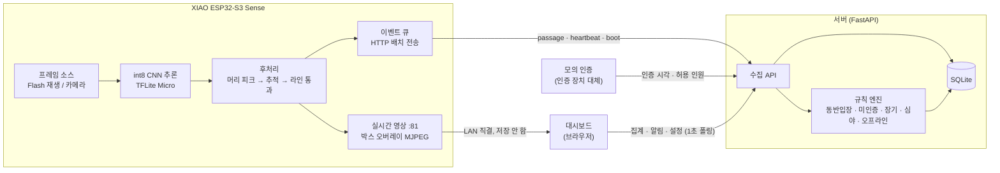

# 무인가게 출입 이상 탐지 설계

천장의 XIAO ESP32-S3 Sense가 **누구인지가 아니라 몇 명이 어느 방향으로 지나갔는지만** 온디바이스(int8)로 판단한다. 서버는 그 결과를 모의 출입 인증 기록과 대조해 동반입장·장기 체류를 감지하고, 대시보드에 표시한다.

## 아키텍처



| 구성 요소 | 역할 |
|---|---|
| **기기 (ESP32-S3)** | 96×72 회색조 프레임에서 머리 중심 히트맵(12×9)을 추론하고, 추적과 가상 라인 2개로 입장·퇴장을 센다. 영상은 서버로 보내지 않고 **통과 이벤트(시각·방향)만** 보낸다 |
| **서버** | 이벤트와 인증을 저장하고, 규칙 엔진이 출입 세션 단위로 동반입장·미인증 입장을, 매장 내 인원으로 장기·심야 체류를 판정한다 |
| **대시보드** | 실시간 영상(기기 직결), 현재 인원, 오늘 누적 입장, 장기 체류 확정 인원, 기준 드롭다운, 알림 목록과 확인 |
| **CI** | 모델 정확도·크기·연산자 게이트, C↔Python 후처리 동치성, 펌웨어 빌드, 서버 테스트, 종단 검증 |

## 통신

| 경로 | 방식 | 내용 |
|---|---|---|
| 기기 → 서버 | HTTP POST `/v1/device/events` (JSON 배치, 1초 또는 8건마다) | `passage`(시각·방향), `heartbeat`(추론 시간·힙·FPS, 2초마다), `boot`. `X-Device-Token` 인증, 이벤트 ID로 재전송 중복 제거, 5xx·타임아웃은 백오프 재시도 |
| 모의 인증 → 서버 | HTTP POST `/v1/auth` | 인증 시각과 허용 인원만 (회원 ID 등 식별자 없음) |
| 대시보드 ↔ 서버 | HTTP GET/PUT | `/v1/occupancy`, `/v1/alerts`, `/v1/settings` 등. 1초 폴링 |
| 기기 → 브라우저 | MJPEG `:81/stream` (같은 LAN, 직결) | 실시간 영상. 조회 패스워드, 동시 시청 1명, **서버 경유·녹화 없음** |
| 시각 | 재생 모드: 시나리오 시각 / 카메라 모드: SNTP | 규칙은 서버 도착 시각이 아니라 **이벤트 시각**으로 판정 |

## 핵심 수치

| 항목 | 값 |
|---|---|
| 모델 | 소형 CNN, 파라미터 6,449개, int8 27.5KB (합성 천장뷰로 학습) |
| 정확도 (합성 테스트 세트) | 단독 통과 0.971 · 밀착 통과 0.978 · 동반입장 재현율 1.000 / 정밀도 0.983 |
| 기기 추론 | 약 41ms/프레임 (ESP32-S3 240MHz, 텐서 아레나 PSRAM) |
| 개인정보 | 영상·이미지 저장 0, 얼굴 인식·재식별 없음, 정의되지 않은 필드 거부 |

자세한 설계는 `docs/01~12`, 측정 결과와 한계(실제 카메라에서의 도메인 갭 등)는 `docs/results.md`.

## 폴더 구조

| 경로 | 내용 |
|---|---|
| `docs/` | 설계 문서 01~12 (요구사항 → 일정) |
| `sim/` | 합성 천장뷰 시나리오 생성기 |
| `ml/` | 학습, int8 양자화, 평가 게이트, 후처리(Python) |
| `firmware/` | ESP-IDF v5.3 펌웨어 (추론, 후처리(C), 전송, 실시간 영상, 재생·카메라 모드) |
| `server/` | FastAPI + SQLite + 규칙 엔진 + 대시보드 |
| `tools/` | 프레임 패키징, 모의 인증 주입기, 종단(e2e) 재생, 시연 스크립트, 합성 영상 재생 페이지 |
| `.github/workflows/` | CI (`docs/09-ci.md`) |

## 실행 (시연)

```bash
tools/flash.sh replay     # 모드를 바꿀 때만: 펌웨어·프레임 쓰기 (replay | camera)
tools/demo.sh replay      # 매번: 서버(새 DB) → 인증 주입 → 보드 리셋. 대시보드 http://localhost:8000
```

Wi-Fi 정보와 토큰은 커밋하지 않는 `firmware/sdkconfig.local`에 둔다. 결과는 `docs/results.md`.
