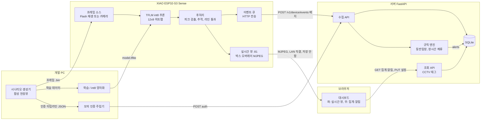
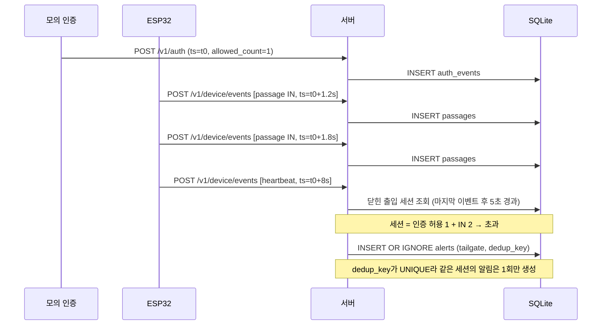

# 02. 전체 아키텍처

## 1. 결정 사항

### 1.1 구성 요소

| 구성 요소 | 위치 | 역할 | 우선순위 |
|---|---|---|---|
| 시나리오 생성기 (`sim/`) | 개발 PC | 합성 천장뷰 프레임 생성, 정답(통과 시각·방향·인원) 생성, 모의 인증 타임라인 생성 | 반드시 |
| 학습·양자화·평가 (`ml/`) | 개발 PC / CI | 모델 학습, int8 PTQ 변환, 정확도·크기 게이트 | 반드시 |
| 펌웨어 (`firmware/`) | XIAO ESP32-S3 Sense | 프레임 재생(또는 카메라), TFLM 추론, 후처리(피크 → 추적 → 라인 통과), 이벤트 전송 | 반드시 |
| 모의 인증 주입기 (`tools/auth_injector.py`) | 개발 PC | 인증 장치 대신 시나리오의 인증 이벤트를 서버로 전송 | 반드시 |
| 서버 (`server/`) | 개발 PC | 수집 API, 규칙 엔진, 조회 API, SQLite | 반드시 |
| 대시보드 (`server/static/`) | 서버가 제공, 브라우저에서 실행 | 인원 집계, 장기 체류 기준 드롭다운, 알림 표시 (외부 알림 채널 없음) | 반드시 |
| 실시간 뷰 (ESP32 `:81/stream`) | ESP32 | 추론 중인 프레임에 검출 박스를 그려 MJPEG로 브라우저에 직접 전송 | 반드시 (실패하면 대체 표시) |

### 1.2 데이터 흐름



영상은 ESP32에서 브라우저로만 직접 흐르고 서버와 DB를 거치지 않는다. 서버로 가는 화살표에는 시각·방향·인원·상태값만 실린다.

### 1.3 동반입장 판정 시퀀스



### 1.4 시각 기준과 규칙 평가 시점

| 항목 | 결정 |
|---|---|
| 이벤트 시각(`ts`) | 재생 모드: `scenario_start_ms + frame_idx × 1000 / fps`. 카메라 모드: SNTP 동기화 시각 |
| 모의 인증 시각 | 주입기가 같은 `scenario_start_ms`를 기준으로 시나리오에 적힌 오프셋을 더해서 전송 |
| 동반입장(`tailgate`), 미인증 입장(`unauth_entry`) | 인증과 IN을 시각순으로 놓고, 이벤트 간격이 5초 이하이면 같은 **출입 세션**으로 묶는다. 세션의 허용 인원 합과 IN 수를 비교한다. 세션이 닫힌 뒤(마지막 이벤트 후 5초) **heartbeat 시점에 평가**한다. 도착 순서가 바뀌거나 인증이 연달아 있어도 결과가 같다 (`07-database.md` 4.1절) |
| 장시간 체류(`long_stay`, `night_stay`) | heartbeat 시점에 평가. 기준 "현재 시각"은 heartbeat의 `ts`(시나리오 시각)로, 시간을 압축한 데모에서도 결정적으로 동작한다 |
| heartbeat | ESP32가 2초(시나리오 시각)마다 전송. 추론 지연·FPS·여유 힙·오류 수를 함께 실어서 시스템 로그로도 쓴다 |
| 기기 오프라인(`device_offline`) | 이 규칙만 예외적으로 서버 수신 시각(벽시계)을 쓴다. 서버가 heartbeat를 10초 이상 받지 못하면 알림을 남긴다. 그 구간은 "감시 공백"으로 태깅해서 CCTV 검색 시 참고하게 한다 (`04-model.md` 1.8절) |
| 유휴 구간 | 시나리오 매니페스트의 `idle_gap_s` 구간에서는 프레임 없이 시계만 진행하고 heartbeat만 보낸다. 장시간 체류 데모에 쓴다 |
| 중복 방지 | 이벤트마다 `event_id = device_id:boot_id:seq`를 붙이고 서버는 UNIQUE로 거부한다. 재전송해도 안전하다 |

### 1.5 저장소 구조

```
edge-doorkeeper/
├─ docs/                      # 설계 문서
├─ sim/                       # 합성 시나리오 생성기
├─ ml/                        # 학습, 양자화, 평가 게이트, Python 후처리(평가용)
├─ firmware/                  # ESP-IDF 프로젝트
│  ├─ main/                   # 프레임 소스, 추론, 전송 태스크
│  └─ components/postproc/    # C 후처리 (호스트에서도 컴파일 가능하게 분리)
├─ server/                    # FastAPI + SQLite + 규칙 엔진
├─ tools/                     # 모의 인증 주입기, 시나리오 패키징
└─ .github/workflows/         # CI
```

후처리는 CI 평가용 Python(`ml/postproc.py`)과 펌웨어용 C(`components/postproc`) 두 벌이 생긴다. 같은 히트맵 입력에서 두 구현의 출력이 같은지 확인하는 동치성 테스트는 **시간이 되면** 넣는다. 최소한으로는 기기 시리얼 로그와 PC 결과를 시나리오 1~2개로 수동 비교한다.

### 1.6 실시간 뷰와 개인정보

**영상 경로 원칙**

| 원칙 | 구현 |
|---|---|
| 서버를 거치지 않음 | 브라우저가 ESP32(`http://<기기 IP>:81/stream`)에 직접 접속한다. 서버는 기기 IP만 알려 주고 영상을 중계하지 않는다 |
| 저장하지 않음 | ESP32는 최신 1프레임만 메모리에 두고 덮어쓴다. 녹화 기능은 만들지 않는다 |
| 같은 LAN에서만 | 외부 포트포워딩 금지 |
| 접근 제한 | 스트림 URL에 토큰을 붙인다 (`?token=`, `menuconfig` 로컬 설정). 동시 시청은 1명 |
| 끌 수 있음 | `CONFIG_DOORKEEPER_LIVE_VIEW` (기본 ON). 실설치 때 끄면 추론과 이벤트 전송만 남는다 |

**모드별 화면**

| 모드 | 좌측 화면 | 개인정보 |
|---|---|---|
| 재생 모드 (이번 데모) | 합성 프레임 + 검출 박스 | 해당 없음 |
| 카메라 모드 | 실제 영상 + 검출 박스 | **실제 사람이 찍히면 개인정보(영상정보)에 해당**한다. 위 원칙과 안내판 설치가 전제 (11단계) |

**개인 식별 가능성 검토**

| 대상 | 시스템 자체의 식별 능력 | 결합하면 식별될 위험 | 대응 |
|---|---|---|---|
| 모델·후처리 | 없음. 얼굴·외형 특징을 추출하지 않는다. 트랙 번호는 화면을 벗어나면 사라지는 임시 번호이고 서버로 보내지 않는다 | — | — |
| DB의 통과·알림 기록 (시각, 방향, 인원) | 없음 | **있음.** CCTV 영상이나 결제·회원 기록의 시각과 맞추면 특정 인물을 가리킬 수 있다. CCTV 검색 보조라는 목적 자체가 이 결합을 전제로 한다 | 인증 기록에 회원 ID·카드번호를 저장하지 않음. 결제는 시간대 집계로만 연동. 보존 30일. 대시보드 접근은 운영자만 |
| 소수 집계 (예: 03시 입장 1명) | 없음 | 있음. 인원이 적으면 집계도 한 사람을 가리킨다 | 외부에 통계를 공유할 때는 작은 수(예: 3명 미만)를 가림 |
| 실시간 뷰 (카메라 모드) | 영상 자체로 외형·옷차림·체형이 보인다. 천장 시점이라 얼굴은 거의 안 보이지만, 아는 사람은 알아볼 수 있다 | 있음 | 위 영상 경로 원칙. 녹화 금지 |

- **결론**: 시스템이 스스로 개인을 식별하지는 않는다. 그러나 **다른 정보와 결합하면 식별 가능성이 생긴다.** 개인정보보호법은 "다른 정보와 쉽게 결합해 알아볼 수 있는 정보"도 개인정보로 본다(제2조 제1호 나목).
- **운영 방침**: 매장 운영자는 CCTV를 함께 갖고 있으므로, DB 기록도 **개인정보에 준해 관리**한다 (보존 기간, 접근 통제). 정확한 법적 해석은 11단계에서 리스크로 다루고, 실서비스 전에는 전문가 확인이 필요하다.

**결정 (2026-11-03): 개인 식별과 동일인 재식별을 모두 하지 않는다**

장기 체류를 정확히 계산하려고 입장자와 퇴장자를 짝짓는 방법을 검토했고, 모두 채택하지 않았다.

| 검토한 방법 | 채택하지 않은 이유 |
|---|---|
| 얼굴 인식 | 원래 범위에서 제외한 항목. 천장 시점과 96×72 해상도로는 불가능. 생체정보라 법적 부담이 큼 |
| 외형 재식별 (머리색·어깨 폭·키로 동일인 매칭) | 특징이 약해서 손님이 많을 때(재식별이 필요한 바로 그때) 매칭이 틀림. 틀리면 장기 체류 오탐이 생김. 신체 특징으로 동일인을 알아보는 처리라 생체인식정보에 해당할 가능성이 높음 |
| 입·퇴장 인증 세션 토큰 | 개인을 식별하지 않고도 정확하지만, 퇴장 인증이라는 운영 변경이 필요함. 이번 범위에서는 채택하지 않고 실서비스 확장안으로만 기록 |

**그 결과 생기는 한계**: 장기 체류는 카메라 집계만으로 계산한 **확정값 1개**로 표시한다 (`07-database.md` 4.2절). 손님이 많을 때는 확정이 늦어진다.

## 2. 결정 근거

- **후처리를 ESP32에서 하는 이유**: 서버로 히트맵을 보내면 데이터량이 늘고, 위치 정보가 시간축으로 쌓여 궤적이 된다. 기기에서 **이벤트로 요약**하는 것이 최소 수집 원칙에 맞다.
- **인증 주입기를 ESP32와 분리하는 이유**: 실제로는 인증 장치와 카메라가 서로 다른 장치다. 분리해 두면 나중에 실제 인증 장치로 교체할 때 서버 쪽만 고치면 된다.
- **heartbeat로 규칙을 평가하는 이유**: 서버 벽시계 타이머를 쓰면 시간을 압축한 시나리오와 CI에서 결과가 실행 속도에 따라 달라진다. 이벤트 시각으로 평가하면 결정적이다.

## 3. 대안과 트레이드오프

| 대안 | 장점 | 단점 | 판단 |
|---|---|---|---|
| 서버 타이머(예: 1초 주기)로 규칙 평가 | 구현이 직관적 | 시나리오 시각과 벽시계가 어긋나고 테스트가 비결정적 | 기각 |
| 히트맵·좌표를 서버로 보내고 서버에서 후처리 | 펌웨어 단순, 후처리를 Python 한 벌로 관리 | 궤적 데이터가 서버에 쌓임, 대역폭 증가, 온디바이스 의미 약화 | 기각 |
| 인증 이벤트도 ESP32가 함께 전송 | 시각 동기 문제 없음 | 실제 구조와 다름 | 기각 |
| 후처리를 C 한 벌로 작성하고 Python에서 ctypes로 호출 | 동치성 보장 | 3시간 안에 빌드 설정 비용이 큼 | 확장안 |
