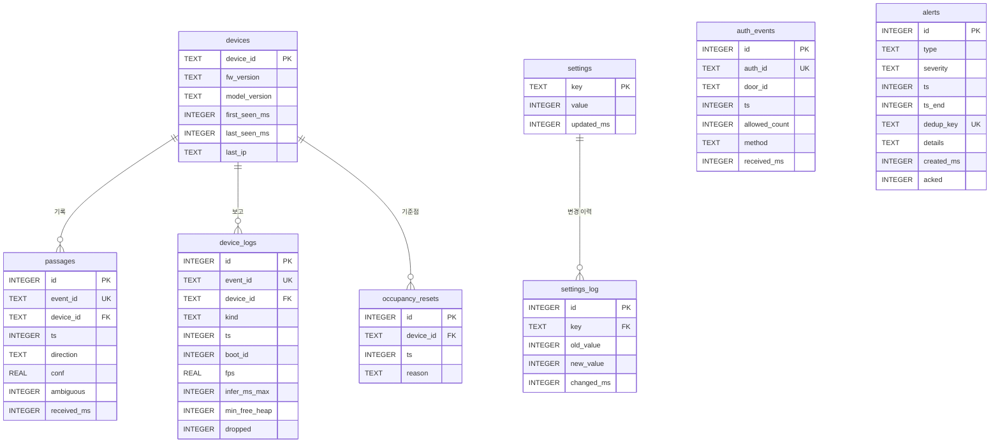

# 07. DB 설계

## 1. DBMS 선택: SQLite (WAL 모드)

| 기준 | SQLite (채택) | PostgreSQL | InfluxDB·TimescaleDB |
|---|---|---|---|
| 운영 비용 | 파일 1개, 설치 없음 (Python 표준 라이브러리) | 서버 프로세스 또는 컨테이너 | 서버 + 별도 쿼리 언어 |
| CI | 임시 파일로 즉시 생성 | 서비스 컨테이너 필요 | 서비스 컨테이너 필요 |
| 필요 기능 | 윈도우 함수(LAG, 누적 SUM) 지원. 세션 묶기와 인원 누적 계산 가능 | 동일, 더 풍부 | 시계열 집계는 강하지만 인증↔통과 대조 같은 관계형 조인에 약함 |
| 쓰기 부하 | 초당 수 건이면 충분 | 과잉 | 과잉 |
| 한계 | 쓰기는 한 프로세스만 가능, 매장이 여러 곳이면 부적합 | — | — |

**결정**: MVP는 SQLite다. SQL을 표준에 가깝게 써서 PostgreSQL로 옮기기 쉽게 한다. 날짜 함수(`strftime`)만 바꾸면 된다.

## 2. 스키마

**설계 원칙**

- 모든 시각은 `INTEGER` epoch ms(UTC)로 저장한다.
- **이미지를 저장할 BLOB 컬럼은 두지 않는다.**
- 식별자 컬럼도 두지 않는다. `device_id`는 장치 ID이고 `auth_id`는 모의 인증 ID다.
- 출입문은 1개, 장치도 1대라고 가정한다(MVP).

### 2.1 ERD



`alerts`와 `auth_events`는 외래키로 묶지 않는다. 알림은 인증 1건이 아니라 "출입 세션"(4.1절) 단위로 생기기 때문이다. 알림이 어느 구간을 가리키는지는 `ts`~`ts_end`로 표현한다.

### 2.2 DDL

```sql
PRAGMA journal_mode = WAL;
PRAGMA foreign_keys = ON;

CREATE TABLE devices (
  device_id     TEXT PRIMARY KEY,
  fw_version    TEXT,
  model_version TEXT,
  first_seen_ms INTEGER NOT NULL,
  last_seen_ms  INTEGER NOT NULL,            -- 서버 수신 시각 (오프라인 감지용)
  last_ip       TEXT                         -- 실시간 뷰 접속 주소용 (기기 IP, 개인정보 아님)
);

CREATE TABLE passages (
  id          INTEGER PRIMARY KEY,
  event_id    TEXT    NOT NULL UNIQUE,       -- device_id:boot_id:seq
  device_id   TEXT    NOT NULL REFERENCES devices(device_id),
  ts          INTEGER NOT NULL,              -- 이벤트 시각
  direction   TEXT    NOT NULL CHECK (direction IN ('in', 'out')),
  conf        REAL    NOT NULL CHECK (conf BETWEEN 0 AND 1),
  ambiguous   INTEGER NOT NULL DEFAULT 0 CHECK (ambiguous IN (0, 1)),
  received_ms INTEGER NOT NULL
);
CREATE INDEX idx_passages_ts     ON passages(ts);
CREATE INDEX idx_passages_dir_ts ON passages(direction, ts);

CREATE TABLE auth_events (
  id            INTEGER PRIMARY KEY,
  auth_id       TEXT    NOT NULL UNIQUE,
  door_id       TEXT    NOT NULL,
  ts            INTEGER NOT NULL,
  allowed_count INTEGER NOT NULL DEFAULT 1 CHECK (allowed_count >= 0),
  method        TEXT    NOT NULL DEFAULT 'mock',
  received_ms   INTEGER NOT NULL
);
CREATE INDEX idx_auth_ts ON auth_events(ts);

CREATE TABLE alerts (
  id         INTEGER PRIMARY KEY,
  type       TEXT    NOT NULL CHECK (type IN
               ('tailgate', 'unauth_entry', 'long_stay', 'night_stay', 'device_offline', 'count_anomaly')),
  severity   TEXT    NOT NULL CHECK (severity IN ('info', 'warn', 'crit')),
  ts         INTEGER NOT NULL,               -- 시작 시각 (CCTV 검색 기준)
  ts_end     INTEGER,                        -- 구간형 알림의 끝
  dedup_key  TEXT    NOT NULL UNIQUE,        -- 같은 상황에 알림 1회
  details    TEXT    NOT NULL DEFAULT '{}',  -- 숫자 요약 JSON만. 예: {"allowed":1,"n_in":2}
  created_ms INTEGER NOT NULL,
  acked      INTEGER NOT NULL DEFAULT 0      -- 대시보드 [확인] 버튼
);
CREATE INDEX idx_alerts_ts      ON alerts(ts);
CREATE INDEX idx_alerts_type_ts ON alerts(type, ts);

CREATE TABLE device_logs (
  id            INTEGER PRIMARY KEY,
  event_id      TEXT    NOT NULL UNIQUE,
  device_id     TEXT    NOT NULL REFERENCES devices(device_id),
  kind          TEXT    NOT NULL CHECK (kind IN ('heartbeat', 'boot')),
  ts            INTEGER NOT NULL,
  boot_id       INTEGER NOT NULL,
  fps           REAL,
  infer_ms_p50  INTEGER,
  infer_ms_max  INTEGER,
  free_heap     INTEGER,
  min_free_heap INTEGER,
  stack_hwm     INTEGER,
  arena_used    INTEGER,
  dropped       INTEGER,                     -- 부팅 이후 누적값
  wifi_rssi     INTEGER,
  mode          TEXT,
  scenario_id   TEXT,
  reset_reason  TEXT,
  received_ms   INTEGER NOT NULL
);
CREATE INDEX idx_logs_dev_ts ON device_logs(device_id, ts);

CREATE TABLE occupancy_resets (
  id        INTEGER PRIMARY KEY,
  device_id TEXT    NOT NULL REFERENCES devices(device_id),
  ts        INTEGER NOT NULL,
  reason    TEXT    NOT NULL CHECK (reason IN ('manual', 'scheduled', 'test'))
);
CREATE INDEX idx_resets_dev_ts ON occupancy_resets(device_id, ts);

-- 대시보드에서 바꾸는 설정 (현재는 장기 체류 기준 1개)
CREATE TABLE settings (
  key        TEXT    PRIMARY KEY,
  value      INTEGER NOT NULL,
  updated_ms INTEGER NOT NULL
);
INSERT INTO settings (key, value, updated_ms) VALUES ('t_long_ms', 1800000, 0);  -- 기본 30분

-- 설정 변경 이력: 알림이 왜 그 시각에 났는지 설명하는 근거
CREATE TABLE settings_log (
  id         INTEGER PRIMARY KEY,
  key        TEXT    NOT NULL REFERENCES settings(key),
  old_value  INTEGER,
  new_value  INTEGER NOT NULL,
  changed_ms INTEGER NOT NULL
);

-- CCTV 검색 보조: 통과와 알림을 하나의 시간축으로 합친 뷰
CREATE VIEW cctv_tags AS
  SELECT ts, NULL AS ts_end, 'passage_' || direction AS tag, id AS ref_id FROM passages
  UNION ALL
  SELECT ts, ts_end, type AS tag, id AS ref_id FROM alerts;
```

### 2.3 인덱스 근거

| 인덱스 | 쓰는 쿼리 |
|---|---|
| `passages(ts)` | 인원 누적 계산(4.2), 시간대별 통계(4.3), CCTV 태그 기간 검색 |
| `passages(direction, ts)` | 출입 세션 묶기(4.1)의 IN만 범위 조회 |
| `auth_events(ts)` | 출입 세션 묶기(4.1) |
| `alerts(type, ts)` | 종류별 기간 검색 (CCTV 태그, 대시보드) |
| `device_logs(device_id, ts)` | 기기 건강 추세(4.6) |
| UNIQUE `event_id`, `dedup_key` | 재전송 중복 제거, 알림 중복 방지 (`INSERT OR IGNORE`) |

## 3. 규칙 엔진에서 SQL의 위치

`rules.evaluate(conn, now_ms)`는 heartbeat를 받을 때마다 실행된다.

1. 4.1, 4.2의 SQL로 후보를 뽑는다.
2. Python에서 임계값을 비교한다.
3. `INSERT OR IGNORE INTO alerts (..., dedup_key)`로 저장한다.

**작업 분담**: 무거운 작업(정렬, 누적, 그룹화)은 SQL이 맡고, 정책(임계값, 심야 시간대 판단)은 Python이 맡는다.

## 4. 핵심 SQL 쿼리

### 4.1 동반입장·미인증 입장: 출입 세션 대조

인증과 IN을 시각순으로 늘어놓는다. 이벤트 간격이 `:gap_ms`(5초) 이하이면 같은 **출입 세션**으로 묶고, 세션별로 "허용 인원 합"과 "IN 수"를 비교한다.

- **인증이 연달아 있는 경우**: 인증 2회 + IN 2명은 정상으로 판정된다. 인증 1건마다 창을 따로 보면 이 경우를 동반입장으로 오탐한다.
- **도착 순서와 무관**: 이벤트 시각만 쓰므로 도착 순서가 바뀌어도 결과가 같다.

```sql
WITH ev AS (
  SELECT ts, allowed_count AS allowed, 0 AS n_in
  FROM auth_events
  WHERE ts > :since AND ts <= :now
  UNION ALL
  SELECT ts, 0, 1
  FROM passages
  WHERE direction = 'in' AND ts > :since AND ts <= :now
),
marked AS (
  SELECT ts, allowed, n_in,
         CASE WHEN LAG(ts) OVER w IS NULL OR ts - LAG(ts) OVER w > :gap_ms
              THEN 1 ELSE 0 END AS is_new
  FROM ev
  WINDOW w AS (ORDER BY ts)
),
sess AS (
  SELECT ts, allowed, n_in,
         SUM(is_new) OVER (ORDER BY ts ROWS UNBOUNDED PRECEDING) AS sid
  FROM marked
)
SELECT MIN(ts)      AS start_ts,
       MAX(ts)      AS end_ts,
       SUM(allowed) AS allowed,
       SUM(n_in)    AS n_in
FROM sess
GROUP BY sid
HAVING MAX(ts) < :now - :gap_ms        -- 닫힌 세션만 (뒤늦게 올 이벤트 대기)
   AND SUM(n_in) > SUM(allowed);
```

**판정**

| 조건 | 알림 | `dedup_key` |
|---|---|---|
| `allowed = 0` | `unauth_entry` | `unauth_entry:{start_ts}` |
| 그 외 | `tailgate` | `tailgate:{start_ts}` |

**파라미터**

| 파라미터 | 값 |
|---|---|
| `:since` | `:now − 10분` (탐색 범위 제한) |
| `:gap_ms` | 5000 |

**알려진 한계**: 사람이 끊임없이 드나들면 세션이 길게 이어진다. 그러면 큰 세션 안의 1명 초과가 묻힐 수 있다. 무인매장의 통행량에서는 드문 경우로 보고, 11단계 리스크에 기록한다.

### 4.2 매장 내 인원과 장기 체류 확정 인원 (장시간·심야 체류)

개인을 추적하지 않으므로 "누가 나갔는지"는 모른다. 그래도 **확실히 T분 이상 머문 최소 인원**은 계산할 수 있다.

> **장기 체류 확정 인원 = max(0, 현재 인원 − 최근 T분 안에 들어온 인원)**

- **근거**: 지금 안에 있는 사람은 "최근 T분 안에 들어온 사람"이거나 "그 전에 들어온 사람" 둘 중 하나다. 최근에 들어온 사람은 많아야 (최근 입장 수)명이다. 그러므로 나머지는 **반드시** T분 이상 머문 사람이다.
- 대시보드에는 이 값 하나만 표시한다.
- **이전 정의와의 차이**: 이전 정의("매장이 T분 동안 비지 않음")는 손님이 짧게 끊임없이 드나들어도 알림을 냈다. 이 정의는 **오탐이 없다** (카운트가 정확하다는 전제).

**알려진 한계: 붐빌 때 지연된다**

- **현상**: 최근 T분 안의 입장 수가 현재 인원 이상이면, 장기 체류자가 있어도 확정값이 0이다.
  - 검증 예: 1명이 60분 머무는 동안 다른 손님 11명이 5분 간격으로 4분씩 머물고 나감 → T=30분에서 현재 인원 1, 최근 입장 6 → 확정 0.
- **놓치는 것이 아니라 늦어진다**: 입장이 뜸해져 "최근 입장 < 현재 인원"이 되는 순간 확정된다. 예를 들어 마지막 입장 후 T분이 지나면 확정된다.
- **보완**: 무인매장은 대체로 통행량이 적다. 숨어 있다가 영업이 끝난 뒤 남는 시나리오는 심야 체류(`night_stay`) 알림이 잡는다.
- **구조적 한계**: 입장자와 퇴장자를 짝짓지 않는 한 이 한계는 없앨 수 없다. 이 프로젝트는 개인 식별과 재식별을 모두 하지 않기로 결정했다 (`02-architecture.md` 1.6절). 리스크 문서(11단계)에 기록한다.

```sql
WITH base AS (
  SELECT COALESCE(MAX(ts), 0) AS reset_ts
  FROM occupancy_resets
  WHERE device_id = :device_id AND ts <= :now
),
p AS (
  SELECT passages.ts, passages.direction
  FROM passages, base
  WHERE passages.device_id = :device_id
    AND passages.ts > base.reset_ts AND passages.ts <= :now
)
SELECT
  COALESCE(SUM(direction = 'in'), 0) - COALESCE(SUM(direction = 'out'), 0)  AS occ_now,
  COALESCE(SUM(direction = 'out'), 0)                                       AS out_total,
  MAX(0, COALESCE(SUM(direction = 'in'), 0) - COALESCE(SUM(direction = 'out'), 0)
         - COALESCE(SUM(direction = 'in' AND ts > :now - :t_long_ms), 0))   AS long_stay_confirmed
FROM p;
```

**CCTV 검색용 입장 구간**: 장기 체류자의 정확한 입장 시각은 알 수 없다. 대신 **확실히 성립하는 구간**은 구할 수 있다.

- 시작: 매장이 마지막으로 비었던 시점 이후의 첫 입장 (`episode_start`)
- 끝: `now − T`
- 장기 체류자는 반드시 이 구간 안에 입장했다.
- 이 구간을 알림의 `ts`~`ts_end`로 저장하고, CCTV는 이 구간의 입장 장면을 확인하면 된다.

(처음에는 "먼저 들어온 사람이 먼저 나간다"는 가정으로 입장 시각 하나를 추정했다. 그런데 위 검증 예에서 실제 0분 입장자를 55분으로 잘못 가리켜서 폐기했다.)

```sql
WITH base AS (
  SELECT COALESCE(MAX(ts), 0) AS reset_ts
  FROM occupancy_resets
  WHERE device_id = :device_id AND ts <= :now
),
seq AS (
  SELECT p.ts,
         SUM(CASE p.direction WHEN 'in' THEN 1 ELSE -1 END)
           OVER (ORDER BY p.ts, p.id ROWS UNBOUNDED PRECEDING) AS occ
  FROM passages p, base
  WHERE p.device_id = :device_id AND p.ts > base.reset_ts AND p.ts <= :now
)
SELECT MIN(ts) AS episode_start
FROM seq
WHERE ts > COALESCE((SELECT MAX(ts) FROM seq WHERE occ <= 0), 0);
```

**판정 (Python)**. `T_long`은 `settings.t_long_ms`에서 읽는다.

| 조건 | 알림 | `ts` ~ `ts_end` | `dedup_key` |
|---|---|---|---|
| `long_stay_confirmed ≥ 1` | `long_stay` | `episode_start` ~ `now − T` | `long_stay:{episode_start}:{확정 인원}` (같은 구간에서 인원이 늘 때만 새 알림) |
| `occ_now > 0` 그리고 `now`가 현지 00:00~05:00 | `night_stay` | `now` | `night_stay:{현지 날짜}:{시}` (1시간에 최대 1회) |
| `occ_now < 0` (퇴장이 입장보다 많음 = 카운트 오차) | `count_anomaly` (데이터 품질) | `now` | `count_anomaly:{현지 날짜}` |

`dedup_key`에 기준 시간 T가 들어가지 않으므로, 대시보드에서 기준을 바꿔도 같은 구간·같은 인원에 대한 알림은 중복되지 않는다. 기준을 낮추면 그다음 heartbeat에서 새로 해당되는 체류가 알림으로 뜬다. 변경 이력은 `settings_log`에 남는다.

**오늘 누적 입장** (대시보드):

```sql
SELECT COUNT(*) AS in_today
FROM passages
WHERE direction = 'in' AND ts >= :day_start_ms AND ts <= :now;  -- day_start_ms = 현지 00:00
```

**인원 수가 틀어질 때**: `occupancy_resets`로 기준점을 다시 잡는다.

- 수동으로 잡거나, 예를 들어 매일 점검 시각에 잡는다.
- 테스트에서는 `reason='test'`로 시나리오마다 0부터 시작한다.

### 4.3 시간대별 방문 통계 (KST)

```sql
SELECT strftime('%Y-%m-%d %H:00', ts / 1000, 'unixepoch', '+9 hours') AS hour_kst,
       SUM(direction = 'in')  AS n_in,
       SUM(direction = 'out') AS n_out
FROM passages
WHERE ts >= :from AND ts < :to
GROUP BY hour_kst
ORDER BY hour_kst;
```

### 4.4 시간대별 인증 대비 입장 (통계 지표)

이 지표는 개인을 의심하는 근거가 아니다. 운영 지표로만 쓴다.

```sql
WITH h_in AS (
  SELECT strftime('%Y-%m-%d %H:00', ts / 1000, 'unixepoch', '+9 hours') AS hour_kst, COUNT(*) AS n_in
  FROM passages WHERE direction = 'in' AND ts >= :from AND ts < :to GROUP BY hour_kst
),
h_auth AS (
  SELECT strftime('%Y-%m-%d %H:00', ts / 1000, 'unixepoch', '+9 hours') AS hour_kst, SUM(allowed_count) AS n_allowed
  FROM auth_events WHERE ts >= :from AND ts < :to GROUP BY hour_kst
)
SELECT h_in.hour_kst, h_in.n_in, COALESCE(h_auth.n_allowed, 0) AS n_allowed,
       ROUND(1.0 * h_in.n_in / NULLIF(h_auth.n_allowed, 0), 2) AS in_per_auth
FROM h_in LEFT JOIN h_auth USING (hour_kst)
ORDER BY h_in.hour_kst;
```

결제 연동은 범위 밖이다. 붙인다면 같은 형태로 `payments` 시간대 집계를 조인하면 된다.

### 4.5 CCTV 영상 검색 보조

```sql
SELECT datetime(ts / 1000, 'unixepoch', '+9 hours') AS at_kst,
       CASE WHEN ts_end IS NULL THEN NULL
            ELSE datetime(ts_end / 1000, 'unixepoch', '+9 hours') END AS until_kst,
       tag, ref_id
FROM cctv_tags
WHERE ts >= :from AND ts < :to
  AND tag IN ('tailgate', 'unauth_entry', 'long_stay', 'night_stay')
ORDER BY ts;
```

### 4.6 기기 건강 추세 (안정성 검증의 증거)

```sql
SELECT strftime('%Y-%m-%d %H:00', ts / 1000, 'unixepoch', '+9 hours') AS hour_kst,
       ROUND(AVG(fps), 1)            AS fps_avg,
       MAX(infer_ms_max)             AS infer_ms_max,
       MIN(min_free_heap)            AS min_free_heap,
       MAX(dropped) - MIN(dropped)   AS dropped_in_hour,   -- 같은 boot 안에서만 의미 있음
       SUM(kind = 'boot')            AS reboots
FROM device_logs
WHERE device_id = :device_id AND ts >= :from AND ts < :to
GROUP BY hour_kst
ORDER BY hour_kst;
```

## 5. 데이터 보존 기간

| 테이블 | 보존 | 근거 |
|---|---|---|
| `passages`, `auth_events` | 30일 | CCTV 검색 보조가 목적이므로 영상 보관 기간에 맞춘다(30일 가정, 매장 정책 확인 필요). 영상이 지워진 뒤의 원시 이벤트는 쓸모가 적다 |
| `alerts` | 90일 | 오탐·미탐 분석과 사후 검토 |
| `device_logs` | 14일 | 장애 분석용. 장기 추세는 집계본으로 대체 |
| 시간대별 집계 테이블 `hourly_stats` | 1년 | 비식별 집계라서 통계 목적으로 장기 보관. 4.3 결과를 매일 저장 |

`hourly_stats` 집계 테이블은 시간이 되면 만든다. 정리 작업은 하루 1회 실행한다 (시간이 되면 구현, 테스트 포함).

```sql
DELETE FROM passages    WHERE ts < :now - 30 * 86400000;
DELETE FROM auth_events WHERE ts < :now - 30 * 86400000;
DELETE FROM alerts      WHERE ts < :now - 90 * 86400000;
DELETE FROM device_logs WHERE ts < :now - 14 * 86400000;
```

## 6. 결정 근거

- **동반입장을 "세션" 단위로 판정하는 이유**: 인증 1건마다 창을 보면 연속 인증 상황에서 오탐이 생긴다. 세션으로 묶으면 SQL 한 번으로 순서 뒤바뀜과 연속 인증을 모두 처리한다.
- **인원 수를 저장하지 않고 계산하는 이유**: 이벤트가 늦게 도착하거나 재전송돼도 다시 계산하면 항상 정확하다. 데이터 규모가 작아서 계산 비용도 문제없다.
- **`dedup_key` UNIQUE를 쓰는 이유**: heartbeat마다 규칙을 평가해도 같은 상황의 알림은 한 번만 생긴다. 별도 상태 관리가 필요 없다.

## 7. 대안과 트레이드오프

| 대안 | 장점 | 단점 | 판단 |
|---|---|---|---|
| 인원 수를 상태 테이블에 증감 저장 | 조회가 빠름 | 도착 순서가 바뀌거나 재전송되면 상태가 오염되고 복구가 어려움 | 기각 (규모가 커지면 집계 캐시로 추가) |
| 인증 1건당 고정 창 대조 | SQL이 단순 | 연속 인증 시 오탐 | 기각 |
| 이벤트를 단일 테이블 + JSON으로 저장 | 스키마 변경이 쉬움 | CHECK 제약과 인덱스가 약해지고, 검증 가능한 개인정보 통제가 어려움 | 기각 |
