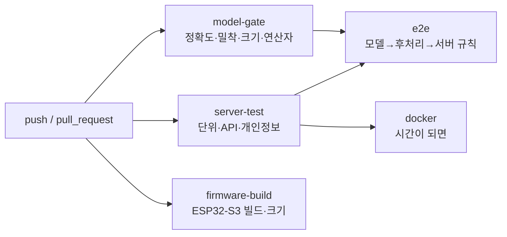

# 09. CI 파이프라인 (GitHub Actions)

## 1. 결정 사항

### 1.1 잡 구성



| 잡 | 내용 | 예상 소요 | 필수 체크 |
|---|---|---|---|
| `model-gate` | 후처리 단위 테스트 → 고정 시드로 테스트 세트 재생성 → 정답 해시 확인 → 커밋된 `model.tflite` 평가 → 게이트 | 4~6분 | ✅ |
| `server-test` | ruff, pytest (규칙 엔진, API, 설정, 개인정보 테스트) | 1~2분 | ✅ |
| `firmware-build` | 커밋 금지 설정 검사 → ESP-IDF v5.3 빌드 → 앱 크기 검사 | 6~10분 | ✅ |
| `e2e` | 가상 기기(PC에서 TFLite + Python 후처리)로 시나리오를 재생하고, 서버(`TestClient`) 규칙 결과를 기대 알림과 대조 | 3~5분 | ✅ |
| `docker` | 서버 이미지 빌드 + `/healthz` 기동 확인. `server/Dockerfile`이 있을 때만 실행 | 2~3분 | 시간이 되면 |

- **병렬 실행**: 잡들이 동시에 돌기 때문에 전체 벽시계 시간은 **약 12~15분**(추정)이다.
- **브랜치 보호**: `main`에 다음 4개 체크를 필수로 걸어 둔다.
  - `model-gate`
  - `server-test`
  - `firmware-build`
  - `e2e`

### 1.2 게이트와 실패 기준

**정확도 정의**: 시나리오 하나에서 예측한 (IN 수, OUT 수)가 정답과 **완전히 같으면** 정답으로 친다. 이벤트 단위 정밀도·재현율·F1은 보고서에만 싣고, 게이트로는 쓰지 않는다.

| 게이트 | 기준 | 대상 |
|---|---|---|
| 단독 통과 정확도 | ≥ 0.90 | `single` |
| **밀착 통과 정확도 (별도 게이트)** | ≥ 0.70 | `side_by_side` + `front_back` |
| 양자화 손실 | float 대비 정확도 하락 ≤ 2.0%p | 전체 (`occluded_pair` 제외) |
| 모델 크기 | ≤ 256KB | `model.tflite` |
| 연산자 목록 | {CONV_2D, DEPTHWISE_CONV_2D, LOGISTIC}의 부분집합 | 펌웨어 `MicroMutableOpResolver`와 일치해야 함. 어긋나면 기기에서 실행 중 실패하므로 CI에서 먼저 잡는다 |
| 입출력 형식 | 입력 `[1,72,96,1]` int8, 출력 `[1,9,12,1]` int8 | 펌웨어 전처리와 일치 |
| 테스트 세트 고정 | 재생성한 정답 해시 = `sim/test_set.sha256` | 생성기 변경으로 게이트 기준이 몰래 바뀌는 것 방지 |
| 동반입장 재현율 / 정밀도 | 각각 ≥ 0.80 | `e2e`, 인증 패턴 포함 시나리오 |
| 앱 크기 | ≤ factory 파티션(2MB)의 90% | 펌웨어 |
| 비밀값 미커밋 | `sdkconfig.defaults`에 Wi-Fi 비밀번호·토큰 값 없음, `sdkconfig` 파일 없음 | 펌웨어 |
| 서버 테스트 | 실패 0 | pytest |

**보고만 하는 지표** (게이트 아님)

- `occluded_pair` 정확도 (알려진 한계)
- 5 FPS 조건 정확도 (시간이 되면)
- 이벤트 F1
- 범주별 혼동표

결과는 잡 요약(`$GITHUB_STEP_SUMMARY`)에 표로 출력한다.

`ml/gates.yaml`:

```yaml
model:
  max_size_bytes: 262144
  allowed_ops: [CONV_2D, DEPTHWISE_CONV_2D, LOGISTIC]
  input:  {shape: [1, 72, 96, 1], dtype: int8}
  output: {shape: [1, 9, 12, 1],  dtype: int8}
accuracy:
  single_min: 0.90
  adjacent_min: 0.70
  adjacent_categories: [side_by_side, front_back]
  excluded_categories: [occluded_pair]   # 보고만 함
  quant_drop_max_pp: 2.0
e2e:
  tailgate_recall_min: 0.80
  tailgate_precision_min: 0.80
firmware:
  app_partition_bytes: 2097152
  max_usage_ratio: 0.90
```

### 1.3 서버 테스트 범위 (`server/tests`)

| 분류 | 테스트 |
|---|---|
| 규칙: 동반입장 | 인증 1 + IN 2 → `tailgate`. 인증 2 연속 + IN 2 → 알림 없음. 인증 없이 IN → `unauth_entry`. 도착 순서가 바뀌어도 결과 동일. 세션이 닫히기 전에는 알림 없음 |
| 규칙: 체류 | 저통행 장기 체류 → `long_stay` 1회 (`ts`~`ts_end` 구간 검증). 붐비는 경우 확정이 지연되는 동작을 고정하는 테스트. 심야 → `night_stay`. OUT > IN → `count_anomaly`. 기준점 초기화 이후만 집계 |
| 설정 | 허용 값 PUT → 200 + `settings_log` 기록 + 즉시 재평가. 허용되지 않은 값 → 422 |
| 중복·순서 | 같은 배치 재전송 → `duplicates` 집계, 행 수 불변. 같은 상황에 대한 `dedup_key` 알림 1회 |
| **개인정보** | 배치에 정의되지 않은 필드(예: `"image"`) → 422. 문자열 길이 제한 초과 → 422. 본문 16KB 초과 → 413. DB 스키마에 BLOB 컬럼 없음(`sqlite_master` 검사). multipart·바이너리를 받는 라우트가 없음(라우트 목록 검사) |
| 오프라인 | 벽시계를 주입해 heartbeat가 10초 이상 끊기면 `device_offline` |

### 1.4 워크플로 YAML 초안 (`.github/workflows/ci.yml`)

**실제 파일(`.github/workflows/ci.yml`)이 기준이다.** 아래는 설계 당시의 초안이고, 구현하면서 다음을 바꿨다.

| 변경 | 이유 |
|---|---|
| Python 3.12 | 로컬 개발 환경과 동일 |
| model-gate에 `tools.postproc_parity` 추가 | 펌웨어 C 후처리가 Python 구현과 같은지 CI에서도 검사 (테스트 세트 300개) |
| server-test 린트 범위를 저장소 전체(`ruff check .`)로 확대 | 서버 폴더 밖의 코드도 같은 기준으로 검사 |
| 비밀값 검사에 SSID, `sdkconfig.local` 추가 | Wi-Fi 정보 파일이 커밋되지 않았는지 확인 |
| e2e는 시나리오 시작마다 인원 기준점을 넣고, 알림을 시나리오에 붙일 때 구간을 10초 앞당김 | 동반입장 알림 시각은 인증 시각(통과보다 최대 3초 앞)이라 앞 시나리오에 잘못 붙는 채점 버그가 있었다 (구현 중 발견) |

```yaml
name: ci

on:
  push:
    branches: [main]
  pull_request:

concurrency:
  group: ci-${{ github.ref }}
  cancel-in-progress: true

permissions:
  contents: read

env:
  PYTHON_VERSION: "3.12"   # 로컬 개발 환경과 동일 (CLAUDE.md)

jobs:
  model-gate:
    name: 모델 게이트 (정확도·밀착·크기·연산자)
    runs-on: ubuntu-latest
    timeout-minutes: 15
    steps:
      - uses: actions/checkout@v4
      - uses: actions/setup-python@v5
        with:
          python-version: ${{ env.PYTHON_VERSION }}
          cache: pip
          cache-dependency-path: |
            sim/requirements.txt
            ml/requirements.txt
      - run: pip install -r sim/requirements.txt -r ml/requirements.txt
      - name: 생성기·후처리 단위 테스트
        run: pytest -q sim/tests ml/tests
      - name: 테스트 세트 재생성 (고정 시드)
        run: python -m sim.generate --split test --out data/test
      - name: 테스트 세트 정답 해시 확인
        run: python -m sim.hash_gt data/test | diff - sim/test_set.sha256
      - name: 모델 평가와 게이트
        run: |
          python -m ml.evaluate \
            --model ml/model.tflite \
            --float-model ml/model_float.tflite \
            --data data/test \
            --gates ml/gates.yaml \
            --report report/model.json \
            --summary "$GITHUB_STEP_SUMMARY"
      - uses: actions/upload-artifact@v4
        if: always()
        with:
          name: model-report
          path: report/
      - uses: actions/upload-artifact@v4
        with:
          name: test-set
          path: data/test/
          retention-days: 1

  server-test:
    name: 서버 단위·API·개인정보 테스트
    runs-on: ubuntu-latest
    timeout-minutes: 10
    steps:
      - uses: actions/checkout@v4
      - uses: actions/setup-python@v5
        with:
          python-version: ${{ env.PYTHON_VERSION }}
          cache: pip
          cache-dependency-path: server/requirements*.txt
      - run: pip install -r server/requirements.txt -r server/requirements-dev.txt
      - run: ruff check server
      - run: pytest -q server/tests --junitxml=report/server.xml
      - uses: actions/upload-artifact@v4
        if: always()
        with:
          name: server-report
          path: report/

  firmware-build:
    name: 펌웨어 빌드 (ESP32-S3)
    runs-on: ubuntu-latest
    timeout-minutes: 20
    steps:
      - uses: actions/checkout@v4
      - name: 커밋 금지 설정 검사 (Wi-Fi 비밀번호, 토큰)
        run: |
          if grep -E '^CONFIG_DOORKEEPER_(WIFI_PASSWORD|DEVICE_TOKEN|STREAM_TOKEN)="[^"]+"' firmware/sdkconfig.defaults; then
            echo "::error::sdkconfig.defaults에 비밀값이 들어 있습니다"; exit 1
          fi
          if [ -f firmware/sdkconfig ]; then
            echo "::error::firmware/sdkconfig는 커밋하면 안 됩니다"; exit 1
          fi
      - name: 빌드
        uses: espressif/esp-idf-ci-action@v1
        with:
          esp_idf_version: v5.3
          target: esp32s3
          path: firmware
      - name: 앱 크기 검사 (factory 파티션 2MB의 90% 이하)
        run: |
          size=$(stat -c %s firmware/build/edge_doorkeeper.bin)
          limit=$(( 2097152 * 90 / 100 ))
          echo "앱 크기: ${size} / 한도: ${limit} bytes" | tee -a "$GITHUB_STEP_SUMMARY"
          [ "$size" -le "$limit" ]
      - uses: actions/upload-artifact@v4
        with:
          name: firmware
          path: |
            firmware/build/edge_doorkeeper.bin
            firmware/build/bootloader/bootloader.bin
            firmware/build/partition_table/partition-table.bin

  e2e:
    name: 종단 시나리오 (모델 → 후처리 → 서버 규칙)
    needs: [model-gate, server-test]
    runs-on: ubuntu-latest
    timeout-minutes: 15
    steps:
      - uses: actions/checkout@v4
      - uses: actions/setup-python@v5
        with:
          python-version: ${{ env.PYTHON_VERSION }}
          cache: pip
          cache-dependency-path: |
            ml/requirements.txt
            server/requirements.txt
      - run: pip install -r ml/requirements.txt -r server/requirements.txt
      - uses: actions/download-artifact@v4
        with:
          name: test-set
          path: data/test
      - name: 가상 기기로 시나리오 재생 → 서버 규칙 → 기대 알림과 대조
        run: |
          python -m tools.e2e_replay \
            --model ml/model.tflite \
            --data data/test \
            --gates ml/gates.yaml \
            --report report/e2e.json \
            --summary "$GITHUB_STEP_SUMMARY"
      - uses: actions/upload-artifact@v4
        if: always()
        with:
          name: e2e-report
          path: report/

  docker:
    name: 서버 Docker 이미지 (시간이 되면)
    needs: server-test
    runs-on: ubuntu-latest
    timeout-minutes: 10
    steps:
      - uses: actions/checkout@v4
      - name: 이미지 빌드
        if: hashFiles('server/Dockerfile') != ''
        run: docker build -t edge-doorkeeper-server:${{ github.sha }} server
      - name: 기동 확인
        if: hashFiles('server/Dockerfile') != ''
        run: |
          docker run -d --name srv -p 8000:8000 edge-doorkeeper-server:${{ github.sha }}
          for i in $(seq 1 20); do
            curl -fsS localhost:8000/healthz && exit 0
            sleep 1
          done
          docker logs srv
          exit 1
```

**초안 작성 시 주의한 점**

- **비밀값 검사에 `! grep`을 쓰지 않은 이유**: bash의 `set -e`는 `!`로 뒤집은 명령의 실패를 무시한다. 그래서 검사가 실제로는 동작하지 않는다. 대신 `if grep ...; then exit 1; fi` 형태로 썼다.
- **Docker 잡의 조건 위치**: `hashFiles()`는 잡 수준 `if`에서 쓸 수 없다. 그래서 스텝마다 조건을 붙였다. Dockerfile이 없으면 잡은 성공(건너뜀)으로 끝난다.
- **모델 파일 경로**: 펌웨어는 `main/CMakeLists.txt`에서 `EMBED_FILES "${CMAKE_SOURCE_DIR}/../ml/model.tflite"`로 모델을 넣는다. `esp-idf-ci-action`은 저장소 전체를 컨테이너에 마운트하므로 상위 경로를 참조할 수 있다. **실제 첫 실행에서 확인이 필요하다.**
- **바이너리 이름**: `firmware/CMakeLists.txt`의 `project(edge_doorkeeper)` 이름을 따른다.

### 1.5 CI 밖에서 하는 검증

- 실기기 테스트는 GitHub 호스티드 러너에 보드를 연결할 수 없어서 CI에 넣지 않는다. 대상은 다음과 같다.
  - PC↔기기 동치성
  - 추론 시간
  - 소크 테스트
  - 실시간 뷰
- 대신 `10-test-plan.md`의 체크리스트로 수동 수행하고, 결과를 heartbeat 로그(DB)와 문서에 기록한다.
- **확장안**: 보드를 연결한 PC를 self-hosted 러너로 등록해 HIL 잡을 추가한다.

## 2. 결정 근거

- **CI가 학습하지 않고 커밋된 모델만 평가하는 이유**: 학습은 시간이 들고 결과가 실행마다 미세하게 달라진다. 게이트의 목적은 "**기기에 올라갈 바로 그 파일**이 기준을 넘는가"이다.
- **밀착 게이트를 따로 두는 이유**: 전체 정확도 안에서는 밀착 통과 성능 저하가 가려진다 (`01-requirements.md`).
- **연산자·입출력 형식 게이트를 두는 이유**: 모델과 펌웨어가 따로 바뀌면 빌드는 둘 다 성공해도 기기에서 실행 중 실패한다. 이 계약을 PC에서 미리 검사한다.
- **e2e를 하드웨어 없이 하는 이유**: 규칙 엔진의 정확도(동반입장 재현율·정밀도)는 모델 출력과 서버 규칙을 함께 봐야 의미가 있다. PC에서 같은 `.tflite`와 같은 후처리 알고리즘으로 재현할 수 있다.

## 3. 대안과 트레이드오프

| 대안 | 장점 | 단점 | 판단 |
|---|---|---|---|
| CI에서 학습까지 수행 | 재현성 증명 | 시간·비결정성, 무료 러너 한계 | 기각 (`workflow_dispatch` 수동 학습 잡은 확장안) |
| 테스트 세트를 저장소에 커밋 | 재생성 시간 0 | 저장소 비대 (수십 MB) | 기각 (해시만 커밋) |
| PlatformIO로 펌웨어 빌드 | 설정 단순 | ESP-IDF 컴포넌트 매니저(esp-tflite-micro)와 버전 맞추기 번거로움 | 기각 |
| Wokwi 시뮬레이터 HIL | 보드 없이 기기 테스트 | 카메라·PSRAM·TFLM 성능 재현 한계, 설정 비용 | 확장안 |
| 경로 필터로 잡 선택 실행 | 시간 절약 | 모델↔펌웨어 계약이 깨져도 놓칠 위험 | 기각 (항상 전체 실행) |
